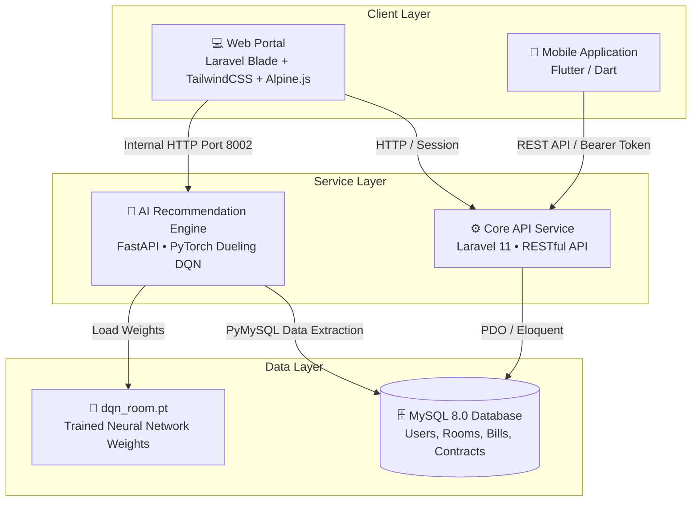
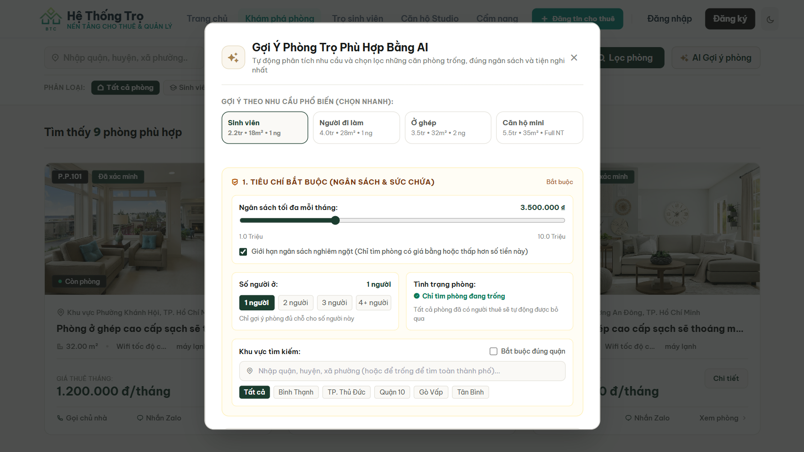
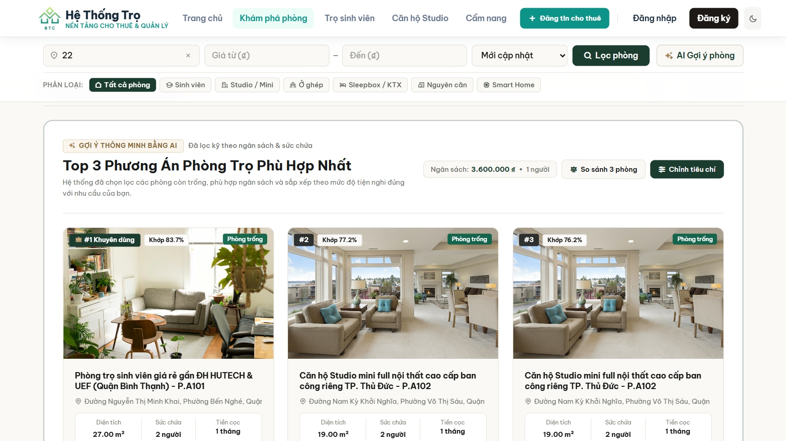
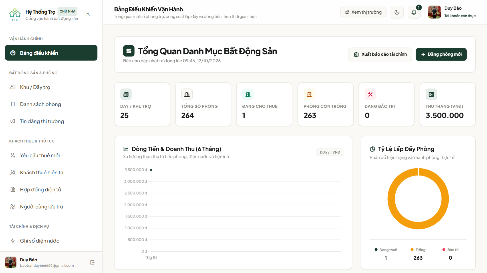

# 🏠 RentSmart — Hệ Thống Quản Lý Nhà Trọ Thông Minh & Gợi Ý Phòng Bằng Reinforcement Learning

<p align="center">
  <a href="https://rentsmart-3jpu.onrender.com" target="_blank">
    
  </a>
</p>

<p align="center">
  
  
  
  
  
  
  
</p>

---

## 📌 1. Giới Thiệu Dự Án (Overview)

**RentSmart** là giải pháp nền tảng toàn diện giải quyết bài toán số hóa quy trình quản lý nhà trọ và kết nối khách thuê. Điểm nhấn đột phá của hệ thống là việc ứng dụng **Học máy tăng cường (Reinforcement Learning - Dueling DQN)** để tư vấn và đề xuất phòng trọ cá nhân hóa, tối ưu hóa đồng thời các mục tiêu: **ngân sách, diện tích, vị trí và tiện ích sinh hoạt**.

### 🌟 Vấn đề giải quyết:
- **Đối với khách thuê:** Loại bỏ tình trạng thông tin ảo, tiết kiệm thời gian tìm kiếm thông qua trợ lý AI phân tích nhu cầu thực tế.
- **Đối với chủ trọ:** Tự động hóa tính tiền điện/nước hàng tháng, xuất hóa đơn minh bạch, quản lý hợp đồng thuê và dòng tiền hiệu quả.
- **Đa nền tảng:** Đồng bộ dữ liệu liền mạch giữa **Web Portal** và **Mobile App**.

---

## 🏗️ 2. Kiến Trúc Hệ Thống (Architecture)

Hệ thống được thiết kế theo kiến trúc Microservices kết hợp Modular Monolith, phân tách độc lập giữa tầng giao diện, tầng xử lý nghiệp vụ và tầng tính toán AI:



---

## 🧠 3. Điểm Nhấn Công Nghệ: AI Recommendation (Dueling DQN)

Khác với các hệ thống gợi ý truyền thống (Collaborative Filtering bị vấn đề *Cold-start* khi phòng mới đăng), RentSmart mô hình hóa bài toán tìm phòng dưới dạng **Môi trường Quyết định Markov (MDP)**:

- **State (Trạng thái - 8 chiều):** Tỷ lệ giá so với ngân sách, độ lệch diện tích, độ khớp tiện ích, trạng thái yêu thích, số ngày phòng trống, tính khả dụng, độ phù hợp sức chứa, độ khớp khu vực địa lý.
- **Dueling Architecture:** Tách lớp ẩn thành 2 nhánh:
  $$\ Q(s, a) = V(s) + \left( A(s, a) - \frac{1}{|A|} \sum_{a'} A(s, a') \right) $$
  Giúp mô hình đánh giá giá trị tổng quát của cấu hình người dùng $V(s)$ mà không phụ thuộc vào từng hành động riêng lẻ.
- **Hard-Constraint Gate (Cổng kiểm định bắt buộc):** Kiểm tra 100% phòng còn trống, đáp ứng đủ sức chứa và không vượt trần ngân sách trước khi chấm điểm xếp hạng.
- **Explainable AI (XAI):** Tự động sinh báo cáo đối chiếu minh bạch lý do đề xuất, các tiêu chí đáp ứng và điểm cần lưu ý thực tế.

---

## 📸 4. Hình Ảnh Giao Diện & Trải Nghiệm Thực Tế (Screenshots)

> **Mẹo:** Đặt ảnh chụp màn hình vào thư mục `docs/images/` với tên tương ứng để hiển thị trực tiếp trên GitHub:

### 🤖 Phân Hệ Khách Thuê: Trợ Lý AI Gợi Ý Phòng
<p align="center">
  
  
</p>
<p align="center"><i>(Trái: Modal cấu hình ràng buộc cứng & sở thích — Phải: Top 3 phòng tối ưu kèm điểm tương thích % và giải thích tiêu chí XAI)</i></p>

### 🏢 Phân Hệ Chủ Trọ: Bảng Điều Khiển Quản Trị & Vận Hành
<p align="center">
  
</p>
<p align="center"><i>(Giám sát công suất lấp đầy phòng, trạng thái phòng trống/đã thuê và biểu đồ doanh thu theo thời gian thực)</i></p>

---

## 🚀 5. Các Tính Năng Nổi Bật (Key Features)

### 👤 Khách Thuê (Tenant)
- 🔍 **Tìm kiếm & Lọc nâng cao:** Tra cứu phòng theo khoảng giá, diện tích, khu vực, tiện ích.
- 🤖 **Gợi ý thông minh 1-chạm:** Các cấu hình cài sẵn cho Sinh viên, Người đi làm, Ở ghép, Căn hộ mini.
- ⚖️ **Bảng so sánh đa chiều:** Đối chiếu trực tiếp 3 phòng trọ được đề xuất tốt nhất.
- 🧾 **Quản lý tài chính:** Tra cứu hóa đơn tiền điện/nước từng tháng, lịch sử thanh toán.
- ✍️ **Đánh giá & Phản hồi:** Gửi nhận xét minh bạch sau thời gian thuê.

### 🏢 Chủ Trọ (Landlord)
- 📊 **Dashboard trực quan:** Thống kê tỷ lệ lấp đầy phòng, doanh thu tháng, công nợ hiện tại.
- 🏠 **Quản lý Dãy trọ & Phòng trọ:** Thiết lập thông tin phòng, giá thuê, định mức tiền cọc.
- ⚡ **Chốt chỉ số điện / nước:** Nhập chỉ số cũ - mới theo tháng, hệ thống tự động tính thành tiền.
- 📄 **Quản lý Hợp đồng:** Lưu trữ cam kết pháp lý, thời hạn hợp đồng và danh sách người thuê.
- 📢 **Quản lý Tin đăng:** Đăng bài cho thuê phòng mới lên sàn công cộng.

### 🛡️ Quản Trị Viên (Admin)
- 📈 **Báo cáo tổng hợp:** Giám sát người dùng, duyệt tin đăng tự động / thủ công.
- 🔐 **Phân quyền bảo mật:** Quản lý vai trò (Admin, Chủ trọ, Khách thuê).

---

## 📂 6. Cấu Trúc Mã Nguồn (Directory Structure)

```text
Source_code/
├── nhatro-main/            # Web Portal (Laravel Blade, Controllers, Views)
├── NhaTro1/
│   └── nha-tro-api/        # Backend RESTful API Core
├── ai_engine/              # AI Microservice (FastAPI, PyTorch, DQN Model)
│   ├── api.py              # API Endpoints (/recommend, /score)
│   ├── dqn_model.py        # Dueling DQN Neural Network Architecture
│   ├── dqn_room.pt         # Trọng số mô hình đã huấn luyện
│   ├── utils.py            # Feature Extraction & Hard-Constraint Filter
│   └── train_dqn.py        # Kịch bản huấn luyện mô hình RL
├── DATN_Mobile/            # Ứng dụng di động (Flutter Project)
├── nha_tro_clean.sql       # Cơ sở dữ liệu mẫu & cấu trúc bảng
└── README.md               # Tài liệu dự án
```

---

## 🛠️ 7. Hướng Dẫn Cài Đặt Local (Installation Guide)

### Yêu Cầu Môi Trường
- **PHP** >= 8.2 (Khuyên dùng PHP 8.3)
- **Composer** >= 2.x
- **Node.js** >= 18.x & NPM
- **Python** >= 3.10
- **MySQL** >= 8.0 (hoặc MariaDB 10.4+)

---

### Bước 1: Khởi Tạo Cơ Sở Dữ Liệu
1. Tạo cơ sở dữ liệu `nha_tro` trên MySQL.
2. Import tệp dữ liệu có sẵn:
```bash
mysql -u root -p nha_tro < nha_tro_clean.sql
```

---

### Bước 2: Cấu Hình & Chạy Backend API (Cổng 8000)
```bash
cd NhaTro1/nha-tro-api
cp .env.example .env
composer install
php artisan key:generate
# Cập nhật thông tin DB_DATABASE, DB_USERNAME, DB_PASSWORD trong file .env
php artisan serve --port=8000
```

---

### Bước 3: Cấu Hình & Chạy AI Engine (Cổng 8002)
```bash
cd ai_engine
# Tạo môi trường ảo (Khuyên dùng)
python -m venv venv
venv\Scripts\activate      # Windows
# source venv/bin/activate # Linux / macOS

pip install fastapi uvicorn torch pymysql pandas numpy
python -m uvicorn api:app --host 127.0.0.1 --port 8002
```

---

### Bước 4: Cấu Hình & Chạy Web Portal (Cổng 8001)
```bash
cd nhatro-main
cp .env.example .env
composer install
npm install
npm run build
php artisan key:generate
# Cập nhật cấu hình DB và AI_RECOMMEND_ENDPOINT=http://127.0.0.1:8002/recommend_top3 trong .env
php artisan serve --port=8001
```

👉 Truy cập hệ thống tại: **`http://127.0.0.1:8001`**

---

## 👨‍💻 Tác Giả & Liên Hệ (Author)

- **Họ và tên:** *Duy Bao*
- **Chuyên ngành:** Kỹ thuật Phần mềm / Công nghệ Thông tin
- **Email:** *baotranduy666666@gmail.com*


---

<p align="center">
  <i>Được xây dựng với niềm đam mê dành cho công nghệ và trải nghiệm người dùng.</i>
</p>
